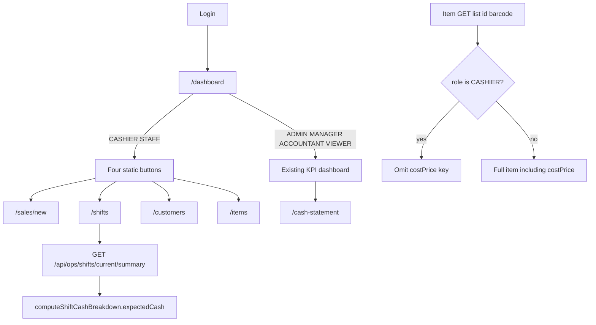

# Sahl cashier feel (home, treasury, hide cost)

* **Author:** Nour Soft
* **Status:** In Review
* **Date:** 2026-11-05

--------------------------------------------------------------------------------

## Overview

Galaxy Cashier (CASR) is a local Windows POS (Electron + Next.js 14 + Express + SQLite) for Egyptian shops. Currency is EGP. UI is Arabic RTL first.

Sahl, in this document, means three shop behaviors: the first screen after login is a few large actions, one button opens the cash drawer screen, and a cashier cannot learn item cost from the items list, barcode lookup, or the POS warning. This design does not copy getsahl.com pixel-for-pixel.

This change is three slices on existing routes. It does not reopen ROADMAP Wave 1 (warehouses, item ledger, sales analysis).

Predecessor: [docs/designs/concepts_brief.md](concepts_brief.md).

## Problem Statement

After login, CASHIER lands on `/dashboard`: KPI cards, a receipts tile that links to `/vouchers` (layout redirects CASHIER away), a cash tile that links to `/cash-statement` when no shift is open (layout redirects CASHIER away), and a small quick-link row. Sidebar is already filtered, but the first screen is still a KPI dashboard.

Two cash numbers exist and the dashboard mixes them:

* Shift drawer: `computeShiftCashBreakdown` in `apps/api/src/services/shift.service.ts`. Formula: `openingCash + cashIn − cashRefunds + receipts − disbursements − expenses`. Exposed as `GET /api/ops/shifts/current/summary`.
* Store-day statement: `/cash-statement`, roles ADMIN/MANAGER/ACCOUNTANT. CASHIER is redirected by `apps/web/src/app/(dashboard)/layout.tsx`.

Item cost leaks to CASHIER: `GET /api/items`, `GET /api/items/:id`, `GET /api/items/barcode/:barcode` return Prisma `costPrice`. POS in `apps/web/src/app/(dashboard)/sales/new/page.tsx` stores that field (including `Number(item.costPrice) || 0` on barcode add and parked resume) and prints it in the below-cost banner and per-line warning. The items table hides the column but still loads `costPrice`. `GET /api/reports/today-summary` allows CASHIER and returns `cogsTotalEGP`, `grossProfitEGP`, `netProfitEGP`. `FinancialSummary` is not rendered when `user.role === 'CASHIER'` in `dashboard/page.tsx`; STAFF still sees it.

## Goals

* CASHIER and STAFF open `/dashboard` and see exactly four large action buttons: new sale, treasury, customers, items. No KPI StatCards, no quick-link grid, no FinancialSummary, no ProductMovementSummary, no HTTP calls on that page.
* CASHIER/STAFF Treasury is a link to `/shifts`. Drawer cash is `expectedCash` from `computeShiftCashBreakdown` on that page. No open shift: existing `/shifts` open-shift UI (do not add a new CTA on dashboard).
* ADMIN/MANAGER/ACCOUNTANT keep the current KPI dashboard. Their cash-statement nav stays `/cash-statement`. This wave does not retarget their KPI cash card.
* CASHIER item JSON omits the `costPrice` key on `GET /api/items` (each element of `data.items`), `GET /api/items/:id` (`data`), and `GET /api/items/barcode/:barcode` (`data`). CASHIER today-summary omits `cogsTotalEGP`, `grossProfitEGP`, `netProfitEGP`. POS does not store or display `costPrice` for CASHIER. Confirm/return/shift still cost from the database.
* Layout gains explicit `ROUTE_ROLES` for `/sales`, `/quotes`, `/customers`, `/items` plus CASHIER-denied item mutation URLs.
* New home button labels use i18n keys listed in the implementation plan.

## Non-Goals

* New `/home` or `/treasury` routes, cashier-only `DashboardShell`, CASL (capability library), `navCatalog.ts`, new cash tables, merging shift and cash statement.
* Hiding cost from STAFF.
* Omitting `unitCost` / cost from sales invoice GET, quote GET, print, purchase APIs, or reports other than today-summary profit fields.
* Sales reps, Excel invoice designer, branches, expense analysis, historical stock value.
* Blocking below-cost sales.
* Changing `computeShiftCashBreakdown` or adding `source: "shift"` on shift summary.
* Reopening ROADMAP Wave 1 stock/profit features.
* Changing ADMIN/MANAGER KPI cash-card mix (shift vs statement). That mix stays until a later wave.
* Mid-shift cash count widget on `/dashboard`.

## Critical User Journeys (CUJs)

### CUJ 1: Cashier lands on a large-button home

* **Given**: User role is CASHIER or STAFF. Session is valid. `/dashboard` is the post-login route.
* **When**: They open the app after login.
* **Then**: They see four large buttons only (plus Sidebar): new sale (`/sales/new`), treasury (`/shifts`), customers (`/customers`), items (`/items`). No profit widgets. No fetch of `/api/cash-statement/today` or low-stock. ADMIN/MANAGER/ACCOUNTANT/VIEWER still see the current KPI dashboard.

### CUJ 2: Cashier checks the drawer

* **Given**: CASHIER or STAFF with an open shift owned by that user.
* **When**: They tap Treasury on `/dashboard`.
* **Then**: App navigates to `/shifts`. Expected drawer cash is `getShiftSummary().expectedCash` from `computeShiftCashBreakdown`. Physical count and close stay on that page.

### CUJ 3: Cashier with no open shift

* **Given**: CASHIER or STAFF with no open shift.
* **When**: They tap Treasury.
* **Then**: App navigates to `/shifts`. Existing open-shift UI is used. Expected cash is not taken from cash-statement. `/cash-statement` is not linked from `/dashboard`.

### CUJ 4: Manager reviews store-day cash

* **Given**: ADMIN, MANAGER, or ACCOUNTANT.
* **When**: They open `/cash-statement` from Sidebar (or existing dashboard cash card).
* **Then**: They see store-day `closingBalanceEGP`. Shift pages remain available to ADMIN/MANAGER.

### CUJ 5: Cashier cannot learn item cost from item reads or POS

* **Given**: Authenticated CASHIER. They scan a barcode, search items, or resume a parked invoice (`PARKED` sales invoice reloaded into POS).
* **When**: The client calls `GET /api/items`, `GET /api/items/:id`, or `GET /api/items/barcode/:barcode`.
* **Then**: The item object has no `costPrice` key. POS does not show a numeric below-cost warning. Confirm still succeeds and the server still stores line `unitCost` from the database. STAFF/ADMIN/MANAGER still receive `costPrice`. Sales invoice GET/print cost fields are unchanged in this wave.

## Proposed Architecture



### Role map

| Product word | App role | First screen | Treasury |
| --- | --- | --- | --- |
| Owner | ADMIN | KPI dashboard | `/cash-statement` |
| Manager | MANAGER | KPI dashboard | `/cash-statement` |
| Accountant | ACCOUNTANT | KPI dashboard | `/cash-statement` |
| Cashier | CASHIER | Four buttons | `/shifts` |
| Helper who can add items | STAFF | Four buttons | `/shifts` |
| Viewer | VIEWER | KPI dashboard (unchanged, including existing cash card) | No new Treasury button |

### Cash source of truth

| Role | Treasury target | Number | Empty state |
| --- | --- | --- | --- |
| CASHIER, STAFF | `/shifts` | `expectedCash` from `computeShiftCashBreakdown` via `GET /api/ops/shifts/current/summary` | Existing `/shifts` open-shift UI. Do not call `/api/cash-statement/today`. |
| ADMIN, MANAGER, ACCOUNTANT | `/cash-statement` | Existing statement `closingBalanceEGP` | Existing page |

Do not mix the two numbers on the CASHIER/STAFF dashboard. Do not change the breakdown formula. Do not add `source` on the shift payload.

CASHIER/STAFF `/dashboard` must not call `GET /api/cash-statement/today` or `GET` low-stock.

### Home chrome

Keep `apps/web/src/app/(dashboard)/dashboard/page.tsx` as the landing page.

For `CASHIER` and `STAFF`:

* Do not render StatCards, FinancialSummary, ProductMovementSummary, or the quick-link grid.
* Do not perform the current `Promise.all` fetches.
* Render four buttons (min tap 44px) with hardcoded hrefs:
  * `/sales/new` — keys `home.newSale`
  * `/shifts` — keys `home.treasury`
  * `/customers` — keys `home.customers`
  * `/items` — keys `home.items`
* Keep Sidebar. Quotes and returns stay in Sidebar / sales list.

For other roles, leave the current KPI dashboard and quick links unchanged.

### Layout guards

Add these `ROUTE_ROLES` entries **before** any shorter `/items` rule (first match wins):

```text
{ prefix: '/items/new', roles: ['ADMIN', 'MANAGER', 'STAFF'] }
{ prefix: '/sales',     roles: ['ADMIN', 'MANAGER', 'CASHIER', 'STAFF'] }
{ prefix: '/quotes',    roles: ['ADMIN', 'MANAGER', 'CASHIER', 'STAFF'] }
{ prefix: '/customers', roles: ['ADMIN', 'MANAGER', 'CASHIER', 'STAFF', 'ACCOUNTANT'] }
{ prefix: '/items',     roles: ['ADMIN', 'MANAGER', 'CASHIER', 'STAFF'] }
```

CASHIER must not remain on `/items/:id/edit`. Implement a layout check: if `role === 'CASHIER'` and pathname matches `/items/:id/edit`, redirect to `/dashboard`. Do not add a `/treasury` prefix.

VIEWER currently can open `/sales` and `/items` because those prefixes are omitted (allow-all). Adding the prefixes above **removes** VIEWER from `/sales`, `/quotes`, `/items`. ACCOUNTANT loses `/sales` and `/items` if they had them via allow-all. That is intended: those roles are not POS. ACCOUNTANT keeps `/customers`.

### Cost visibility (CASHIER only)

On item list/id/barcode responses, if `req.user.role === 'CASHIER'`, omit the `costPrice` key from each item object (not `null`, not `0`). Controllers pass `req.user.role` into the read functions or strip in the controller after the service returns.

`todaySummaryHandler` currently ignores `req`. Pass `req.user.role`. If CASHIER, omit `cogsTotalEGP`, `grossProfitEGP`, `netProfitEGP` from the JSON. Leave `netSalesEGP` and `last7Days`.

POS `sales/new/page.tsx`:

* Import auth role.
* On barcode add (~`addItemToCart`) and parked resume, if CASHIER, do not assign `costPrice` from the item payload (do not use `Number(x) || 0`).
* If CASHIER, do not render the below-cost banner or the per-line numeric warning (`lossLines` gated).
* ADMIN/MANAGER/STAFF keep the current warning.
* Confirm payload stays without cost.

Items `items/page.tsx`:

* `canManage` stays `ADMIN || MANAGER` for bulk/delete only.
* `canMutateItems = ADMIN | MANAGER | STAFF` for add, import, CSV template, row edit, and scan-to-add/edit. CASHIER sees none of those.

STAFF: no API strip. They still see cost on items and POS.

## Alternatives Considered

### Alternative A: New `/home` route and hide Sidebar for cashiers

* **Pros**: Dedicated POS launcher.
* **Cons**: Second shell, duplicate mobile overlay, two landings.
* **Reason for Rejection**: `/dashboard` already exists and Sidebar is already role-filtered for CASHIER.

### Alternative B: One Treasury page composing shift + cash statement

* **Pros**: One button for every role.
* **Cons**: Different grain (user vs store). Granting CASHIER statement read leaks other users' sales.
* **Reason for Rejection**: Two ledgers stay two screens.

### Alternative C: Field-level permission platform

* **Pros**: Future flags per user.
* **Cons**: No CASL in the repo; roles already drive `requireRole`.
* **Reason for Rejection**: CASHIER-only omit on the three item reads plus today-summary profit fields is the wave boundary.

### Alternative D: Client `belowCost` boolean for cashiers

* **Pros**: Keeps a warning after cost is stripped.
* **Cons**: Cashier can change price/discount until the flag flips and recover cost.
* **Reason for Rejection**: Drop the warning for CASHIER; do not block confirm.

### Alternative E: Shared `navCatalog.ts`

* **Pros**: One list for Sidebar and home.
* **Cons**: Layout `ROUTE_ROLES` would still be a second list. Home hrefs (`/sales/new`) are not a filter of Sidebar (`/sales`). Forces a Sidebar i18n rewrite.
* **Reason for Rejection**: Four dashboard buttons are inline. Sidebar list stays in `Sidebar.tsx`.

## Risks & Mitigations

* **Shift summary fails or returns no open shift.** Dashboard does not call it. `/shifts` already handles empty. Mitigation: no new error UI on home.
* **Old parked invoice in POS still has `costPrice` in React state.** Mitigation: on resume map, drop `costPrice` for CASHIER even if the parked GET still has it; do not render below-cost UI if role is CASHIER.
* **Mixed client: new API + old POS.** Old POS used `Number(costPrice)||0`, so warnings disappear. Acceptable. Rollback restores the JSON field.
* **CASHIER opens `/items/:id/edit` by URL.** Mitigation: layout redirect. Edit page still shows a cost input for STAFF/ADMIN; CASHIER never stays there.
* **CASHIER still allowed on `GET /api/reports/today-summary`.** Mitigation: omit profit fields; dashboard no longer mounts FinancialSummary for CASHIER or STAFF.
* **SQLite load.** Cashier home makes zero extra queries. Item strip is in-process omit after the existing query.

## Non-Functional Requirements

* **Security**: Cost omit is server-side on the three item reads. UI hide is not sufficient. CASHIER does not gain `/cash-statement`.
* **Performance**: CASHIER/STAFF dashboard: zero GETs.
* **Rollout**: No Prisma migration. Rollback restores item JSON `costPrice` and the old dashboard layout.
* **Day boundary**: Shift window is `openedAt` → now. Cashier Treasury does not use cash-statement `toISOString().slice(0, 10)`.

## Additional Resources

* [docs/designs/concepts_brief.md](concepts_brief.md)
* [CASR-README.md](../../CASR-README.md)
* `apps/web/src/app/(dashboard)/dashboard/page.tsx`
* `apps/api/src/services/shift.service.ts`
* `apps/api/src/index.ts` mounts `/api/ops`

## Future Improvements

* Derive layout `ROUTE_ROLES` from one catalog.
* Server-side below-cost block if a shop wants it.
* Cairo calendar date for cash-statement today.
* Stop mixing shift and statement on the ADMIN KPI cash card.

--------------------------------------------------------------------------------

## Detailed Implementation Plan

Work in three slices. Each slice must leave the app bootable.

### Slice A — API omit + test

#### 1. `apps/api/src/controllers/item.controller.ts` (Modify)

* After `getItems` / `getItemById` / `getItemByBarcode`, if `req.user.role === 'CASHIER'`, omit `costPrice` from each item object. Keep the `{ items, total, page, pageSize, totalPages }` envelope. Do not pass `limit`; list uses `page` / `pageSize`.

#### 2. `apps/api/src/controllers/reports.controller.ts` (Modify)

* Change `todaySummaryHandler` to read `req`. If role is CASHIER, omit `cogsTotalEGP`, `grossProfitEGP`, `netProfitEGP` from the JSON. Do not change `reports.service.ts` formula.

#### 3. `scripts/integration-smoke-e2e.cjs` (Modify)

* Ensure user `cashier1` / `cashier123` exists (same pattern as other scripts). Login as cashier, `GET /api/items?page=1&pageSize=1`, assert `data.items[0]` has no `costPrice` key. `GET` one item by id and by barcode, same assert. Login as admin, assert `data.items[0].costPrice` is a number. Cashier `GET /api/reports/today-summary`: no `cogsTotalEGP`, `grossProfitEGP`, or `netProfitEGP`.

**Slice A green:** those assertions pass.

### Slice B — Home + layout

#### 4. `packages/i18n/ar.json` and `packages/i18n/en.json` (Modify)

* Add only:
  * `home.newSale`: ar `فاتورة مبيعات جديدة` / en `New sale`
  * `home.treasury`: ar `الخزينة` / en `Cash drawer`
  * `home.customers`: ar `العملاء` / en `Customers`
  * `home.items`: ar `المنتجات` / en `Items`
* Do not migrate Sidebar labels in this wave. If `apps/web/src/lib/i18n.ts` `t()` is unused in dashboard, hardcode these four Arabic strings in the buttons **or** call `t()` if wiring is one import; prefer `t('home.newSale')` etc. if `t` works without a provider. If `t` cannot run on this page, use the Arabic literals above and still add the JSON keys for the next wiring.

#### 5. `apps/web/src/app/(dashboard)/dashboard/page.tsx` (Modify)

* If `user.role` is `CASHIER` or `STAFF`: render only the four buttons (hrefs above). No `useEffect` fetches. No StatCards, no FinancialSummary, no ProductMovementSummary, no quick links.
* Else: keep the current page.

#### 6. `apps/web/src/app/(dashboard)/layout.tsx` (Modify)

* Insert the `ROUTE_ROLES` rows listed in Layout guards, with `/items/new` before `/items`. Add the CASHIER `/items/:id/edit` redirect.

**Slice B green:** login `cashier1` / `cashier123` shows four buttons and no network call to cash-statement; admin dashboard unchanged.

### Slice C — POS + items UI

#### 7. `apps/web/src/app/(dashboard)/sales/new/page.tsx` (Modify)

* Read `user.role`. For CASHIER, do not set `costPrice` in `addItemToCart` or parked-resume mapping. Gate `lossLines` banner (~line 682) and per-line warning (~line 972) to non-CASHIER. Confirm body unchanged.

#### 8. `apps/web/src/app/(dashboard)/items/page.tsx` (Modify)

* `canMutateItems = role is ADMIN, MANAGER, or STAFF`. Wrap add, import, CSV template, row edit, and scan-to-add/edit. Leave `canManage` for bulk/delete.

**Slice C green:** cashier POS shows no cost number; cashier items page has no add/edit/import; STAFF still has add/edit and sees cost.

### Out of this plan

* Do not create `navCatalog.ts`.
* Do not modify `shift.service.ts`.
* Do not modify `FinancialSummary.tsx` (STAFF/CASHIER home no longer mounts it).
* Do not modify `/shifts` pages (reuse existing open-shift copy).
* Do not modify `QuickAddItemModal` in this wave (CASHIER POST item is already 403).

### Verification Plan

* **API:** `node scripts/integration-smoke-e2e.cjs` after Slice A assertions are added.
* **Web lint:** `npm run lint` in `apps/web`.
* **API build:** `npm run build` in `apps/api`.
* **Manual:** `cashier1` / `cashier123` → four buttons; Treasury → `/shifts`; DevTools item list object has no `costPrice`. `admin` / `admin123` → KPI dashboard, `/cash-statement`, item GET has `costPrice`. STAFF still sees cost and item add.

--------------------------------------------------------------------------------

*Drafted with EGM*
